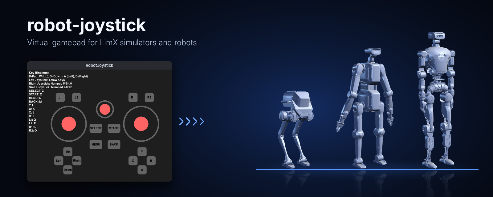
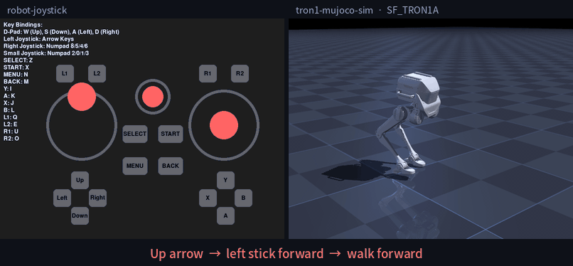
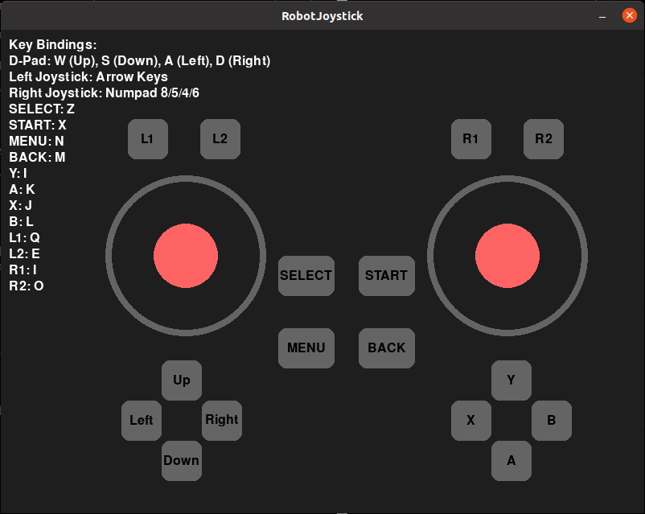

<p align="center">
  
</p>

<p align="center">
  <b>English</b> | <a href="README_cn.md">中文</a>
</p>

<!-- limx-community:start -->
<!-- Managed by limxdynamics/limxdynamics/.github/community/sync_community.py; QR code: doc/wechat_qr.png in that repo -->
<p align="center"><a href="https://github.com/limxdynamics/limxdynamics/blob/main/doc/wechat_qr.png"></a></p>
<!-- limx-community:end -->

<p align="center">
  <a href="LICENSE"></a>
  
  
  
</p>

# robot-joystick

A virtual gamepad for LimX robots. It opens a window with two sticks, a small
stick, a D-pad and the usual face and shoulder buttons, and publishes their
state through the LimX SDK as a `SensorJoy` message about 100 times a second.
Simulators and controllers that read the remote control, such as
[tron1-mujoco-sim](https://github.com/limxdynamics/tron1-mujoco-sim), take it
as if it came from a real gamepad. Drive it with the mouse or the keyboard.

## Demo

<p align="center">
  
</p>

<p align="center"><sub>robot-joystick next to tron1-mujoco-sim running SF_TRON1A with
<a href="https://github.com/limxdynamics/tron1-rl-deploy-python">tron1-rl-deploy-python</a>.
Recorded headless, robot view rendered offline from the simulator state.</sub></p>

## Highlights

- **No install.** Prebuilt single-file programs for Linux x86_64 and Windows
  x86_64; clone and run.
- **Mouse or keyboard.** Drag a stick for a proportional command, or hold a
  key for full deflection.
- **Same message as the real remote.** 6 axes and 18 buttons in a
  `SensorJoy`, sent to `127.0.0.1` by default or to any address you pass.
- **One tool for every LimX simulator.** It ships as the `robot-joystick`
  submodule of tron1-mujoco-sim, humanoid-mujoco-sim and tron2_mujoco_sim.

## Quick start

```bash
git clone https://github.com/limxdynamics/robot-joystick.git
./robot-joystick/robot-joystick              # Linux, sends to 127.0.0.1
./robot-joystick/robot-joystick <robot-ip>   # send to another address
```

On Windows, run `robot-joystick.exe` (optionally with `<robot-ip>`). Start it
next to a running simulator and controller; keep the joystick window focused
while you type.

## Key map

| Control | Keyboard | Mouse |
|---|---|---|
| Left stick | Arrow keys | Drag the left circle |
| Right stick | Numpad 8 / 5 / 4 / 6 (up / down / left / right) | Drag the right circle |
| Small stick | Numpad 2 / 0 / 1 / 3 (up / down / left / right) | Drag the small circle |
| D-pad | W / S / A / D | Click |
| Y / A / X / B | I / K / J / L | Click |
| L1 / L2 / R1 / R2 | Q / E / U / O | Click |
| SELECT / START | Z / X | Click |
| MENU / BACK | N / M | Click |

The window also lists these bindings in its top-left corner.

## Message layout

What each `SensorJoy` field carries, checked by subscribing to the program's
output with the LimX SDK and pressing every key:

| `axes[i]` | Meaning | Sign |
|:-:|---|---|
| 0 | Left stick, horizontal | + left |
| 1 | Left stick, vertical | + up |
| 2 | Right stick, horizontal | + left |
| 3 | Right stick, vertical | + up |
| 4 | Small stick, horizontal | + left |
| 5 | Small stick, vertical | + up |

| `buttons[i]` | 0 | 1 | 2 | 3 | 4 | 5 | 6 | 7 | 8 | 9 | 10, 11 | 12 | 13 | 14 | 15 | 16 | 17 |
|---|---|---|---|---|---|---|---|---|---|---|---|---|---|---|---|---|---|
| Button | A | B | X | Y | L1 | R2 | L2 | R1 | SELECT | START | unused (0) | Up | Down | Left | Right | MENU | BACK |

Axes range from -1 to 1 and return to 0 when the stick is released. Buttons
are 0 or 1. What each input does is up to the controller that reads it; for
TRON1, see the joystick section of
[tron1-rl-deploy-python](https://github.com/limxdynamics/tron1-rl-deploy-python#3-virtual-joystick).

## Used by

| Repository | Robot |
|---|---|
| [tron1-mujoco-sim](https://github.com/limxdynamics/tron1-mujoco-sim) | TRON1 |
| [tron2_mujoco_sim](https://github.com/limxdynamics/tron2_mujoco_sim) | TRON2 |
| [humanoid-mujoco-sim](https://github.com/limxdynamics/humanoid-mujoco-sim) | OLI |

Each includes this repository as its `robot-joystick` submodule.

## 1. Download and Run

- Open a Bash terminal.

- Download the robot-joystick：

  ```
  git clone https://github.com/limxdynamics/robot-joystick.git
  ```

- Run the robot-joystick：

  ```
  ./robot-joystick/robot-joystick
  ```

## 2. Demonstration of Results


## Verification

Checked on Linux x86_64 (Ubuntu 24.04, under Xvfb) with limxsdk 3.4.0:

- With no argument the program publishes to `127.0.0.1`; a LimX SDK subscriber
  received about 91 messages per second. Every key in the key map was pressed
  and the axis or button index in the tables above changed, then returned to
  0 on release. L1 + Y arrived as one message with both buttons set.
- With tron1-mujoco-sim and tron1-rl-deploy-python (`SF_TRON1A`), holding the
  Up arrow walked the robot forward, Numpad 4 turned it left and the Right
  arrow side-stepped it, as in the demo.

The Linux program needs an X display and glibc 2.29 or newer (Ubuntu 20.04+).
`robot-joystick.exe` was unpacked and contains the same program as the Linux
build, but was not run on Windows. Sending to a real robot (`<robot-ip>`) was
not tested on hardware.

## License

Apache License 2.0, see [LICENSE](LICENSE).
