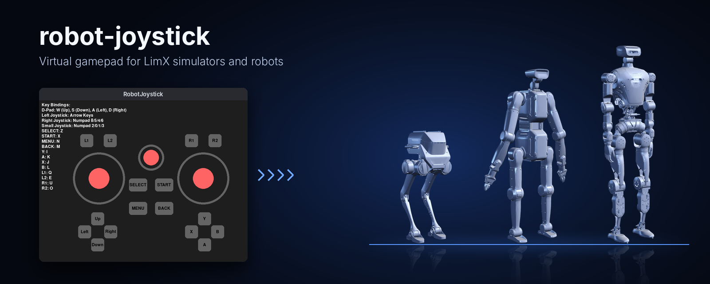
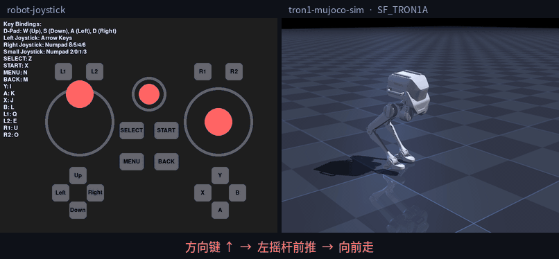
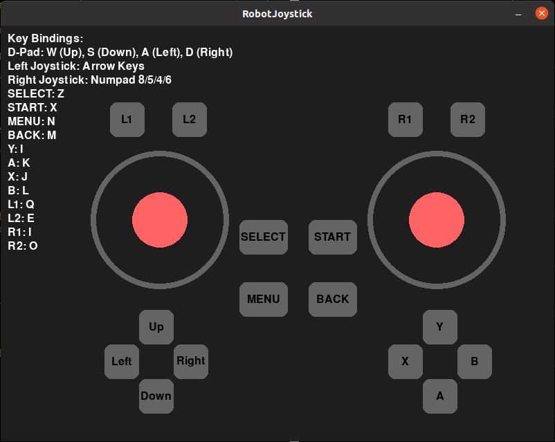

<p align="center">
  
</p>

<p align="center">
  <a href="README.md">English</a> | <b>中文</b>
</p>

<p align="center">
  <a href="LICENSE"></a>
  
  
  
</p>

# robot-joystick

逐际机器人的虚拟手柄。运行后会打开一个窗口，上面有左右两个摇杆、一个小摇杆、方向键，以及常见的功能键和肩键。程序通过 LimX SDK 以约每秒 100 次的频率发布 `SensorJoy` 消息。[tron1-mujoco-sim](https://github.com/limxdynamics/tron1-mujoco-sim) 等读取遥控器输入的仿真器和控制器，会把它当成真实手柄。可以用鼠标或键盘操作。

## 演示

<p align="center">
  
</p>

<p align="center"><sub>左边是 robot-joystick，右边是 tron1-mujoco-sim 中由
<a href="https://github.com/limxdynamics/tron1-rl-deploy-python">tron1-rl-deploy-python</a> 控制的 SF_TRON1A。
无界面环境录制，机器人画面根据仿真状态离线渲染。</sub></p>

## 亮点

- **免安装。** 提供 Linux x86_64 和 Windows x86_64 的单文件程序，克隆下来就能运行。
- **鼠标或键盘都能用。** 拖动摇杆按比例输出，按住按键则直接推到底。
- **消息格式和实体遥控器一致。** `SensorJoy` 包含 6 个轴和 18 个按键，默认发往 `127.0.0.1`，也可以指定其他地址。
- **逐际各仿真器通用。** 它是 tron1-mujoco-sim、humanoid-mujoco-sim 和 tron2_mujoco_sim 的 `robot-joystick` 子模块。

## 快速开始

```bash
git clone https://github.com/limxdynamics/robot-joystick.git
./robot-joystick/robot-joystick              # Linux，发往 127.0.0.1
./robot-joystick/robot-joystick <robot-ip>   # 发往其他地址
```

Windows 下运行 `robot-joystick.exe`，同样可以带 `<robot-ip>` 参数。先启动仿真器和控制器，再运行本程序；按键时要让手柄窗口保持在前台。

## 按键对照

| 控件 | 键盘 | 鼠标 |
|---|---|---|
| 左摇杆 | 方向键 | 拖动左侧大圆 |
| 右摇杆 | 小键盘 8 / 5 / 4 / 6（上 / 下 / 左 / 右） | 拖动右侧大圆 |
| 小摇杆 | 小键盘 2 / 0 / 1 / 3（上 / 下 / 左 / 右） | 拖动中间小圆 |
| 方向键（D-pad） | W / S / A / D | 点击 |
| Y / A / X / B | I / K / J / L | 点击 |
| L1 / L2 / R1 / R2 | Q / E / U / O | 点击 |
| SELECT / START | Z / X | 点击 |
| MENU / BACK | N / M | 点击 |

窗口左上角也列出了这些按键。

## 消息格式

`SensorJoy` 各字段的含义。验证方法：用 LimX SDK 订阅程序发出的消息，逐个按下所有按键核对。

| `axes[i]` | 含义 | 符号 |
|:-:|---|---|
| 0 | 左摇杆，水平 | 向左为正 |
| 1 | 左摇杆，竖直 | 向上为正 |
| 2 | 右摇杆，水平 | 向左为正 |
| 3 | 右摇杆，竖直 | 向上为正 |
| 4 | 小摇杆，水平 | 向左为正 |
| 5 | 小摇杆，竖直 | 向上为正 |

| `buttons[i]` | 0 | 1 | 2 | 3 | 4 | 5 | 6 | 7 | 8 | 9 | 10、11 | 12 | 13 | 14 | 15 | 16 | 17 |
|---|---|---|---|---|---|---|---|---|---|---|---|---|---|---|---|---|---|
| 按键 | A | B | X | Y | L1 | R2 | L2 | R1 | SELECT | START | 未使用（0） | 上 | 下 | 左 | 右 | MENU | BACK |

轴的取值范围是 -1 到 1，松开摇杆后回到 0；按键取 0 或 1。每个输入具体触发什么动作，由读取它的控制器决定。TRON1 的对应关系见 [tron1-rl-deploy-python](https://github.com/limxdynamics/tron1-rl-deploy-python/blob/main/README_cn.md#3-虚拟遥控器) 的虚拟遥控器一节。

## 使用本仓库的项目

| 仓库 | 机器人 |
|---|---|
| [tron1-mujoco-sim](https://github.com/limxdynamics/tron1-mujoco-sim) | TRON1 |
| [tron2_mujoco_sim](https://github.com/limxdynamics/tron2_mujoco_sim) | TRON2 |
| [humanoid-mujoco-sim](https://github.com/limxdynamics/humanoid-mujoco-sim) | OLI |

这些仓库都以 `robot-joystick` 子模块的形式引入本仓库。

## 1. 下载与运行

- 打开一个 Bash 终端。

- 下载 robot-joystick：

  ```
  git clone https://github.com/limxdynamics/robot-joystick.git
  ```

- 运行 robot-joystick：

  ```
  ./robot-joystick/robot-joystick
  ```

## 2. 效果展示


## 验证

在 Linux x86_64（Ubuntu 24.04，Xvfb 无界面环境）上用 limxsdk 3.4.0 验证：

- 不带参数时程序发往 `127.0.0.1`，LimX SDK 订阅端每秒收到约 91 条消息。逐个按下按键对照表中的所有按键，上表对应的轴或按键位都会变化，松开后回到 0。L1 + Y 同时按下时，两个按键位在同一条消息里同时置 1。
- 配合 tron1-mujoco-sim 和 tron1-rl-deploy-python（`SF_TRON1A`）：按住方向键 ↑ 机器人向前走，小键盘 4 左转，方向键 → 向右横移，与演示动图一致。

Linux 版需要 X 图形环境，glibc 2.29 及以上（Ubuntu 20.04+）。`robot-joystick.exe` 已解包核对，与 Linux 版是同一份程序，但没有在 Windows 上实际运行。发往真机（`<robot-ip>`）未在硬件上测试。

## 许可证

Apache License 2.0，见 [LICENSE](LICENSE)。
